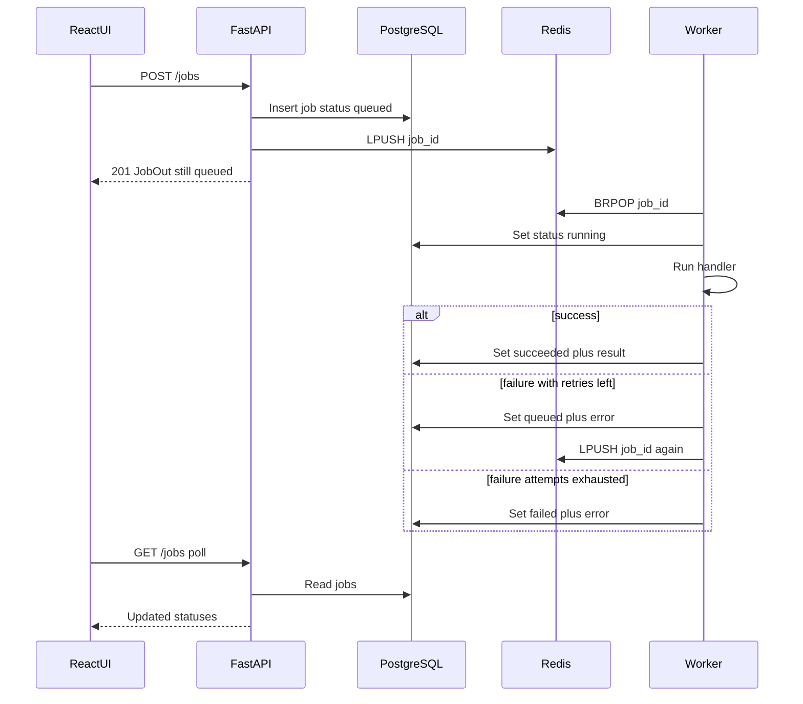

# Job Queue Lab

Backend-focused lab: **enqueue jobs over HTTP → Redis list → worker process → PostgreSQL status**, with a small **React/Vite** UI that polls for updates.

## Architecture

```text
React (:5173)  --POST/GET /jobs-->  FastAPI (:8000)  --LPUSH-->  Redis
                                         |                         |
                                    PostgreSQL                 BRPOP worker
```

### What happens when you enqueue a job



Job lifecycle: `queued` → `running` → `succeeded` | `failed` (retries up to `max_attempts`). Cancel only while `queued`.

### Job types

| Type | Payload | Behavior |
|------|---------|----------|
| `sleep` | `{ "seconds": 1-10 }` | Sleep, return `{ "slept": n }` |
| `http_fetch` | `{ "url": "..." }` | GET URL; store status code + body length |
| `fail` | `{ "message": "..." }` | Always fail (good for retry demos) |

## Prerequisites

- Python 3.11+
- Node.js 18+
- Docker (for Redis + PostgreSQL)

## Quick start

```bash
# 1) Redis + PostgreSQL
docker compose up -d

# 2) API
python -m venv .venv
# Windows: .\.venv\Scripts\Activate.ps1
# macOS/Linux: source .venv/bin/activate
pip install -r requirements.txt
copy .env.example .env   # Windows; or: cp .env.example .env

# from repo root
uvicorn app.main:app --reload --host 0.0.0.0 --port 8000

# 3) Worker (second terminal, same venv + repo root)
python -m app.worker

# 4) UI (third terminal)
cd web
npm install
npm run dev
```

Open http://localhost:5173 — Vite proxies `/jobs` and `/health` to the API.

API docs: http://localhost:8000/docs

## Try this

1. Submit a `sleep` job (2s) → watch `queued` → `running` → `succeeded`.
2. Submit the same question again while watching Redis: the worker uses `BRPOP`.
3. Submit `fail` → see retries (`attempts` climb) then `failed`.
4. Submit `http_fetch` with `https://httpbin.org/get` → inspect result JSON in the detail panel.
5. Enqueue a long `sleep`, click the row while `queued`, hit **Cancel**.

## Layout

```text
app/                 FastAPI API, SQLAlchemy models, Redis queue, worker
web/                 React + Vite + TypeScript UI
notes/               Stack explainers (API, Redis, worker, Postgres, handlers, React)
docker-compose.yml   Redis + PostgreSQL
```

Concept notes: [FastAPI](notes/01_fastapi.md) · [Redis](notes/02_redis_queue.md) · [Worker](notes/03_worker.md) · [PostgreSQL](notes/04_postgresql.md) · [Handlers](notes/05_job_handlers.md) · [React/Vite](notes/06_react_vite.md) · [HTTP](notes/07_http_methods.md) · [CORS](notes/08_cors.md) · [Polling](notes/09_polling_websockets.md) — index in [`notes/`](notes/).

## Learning checklist

- [ ] API and worker are **separate processes**
- [ ] Redis holds **job ids**, PostgreSQL holds **durable status/results**
- [ ] Failed jobs re-queue until `max_attempts`
- [ ] React polls while any job is `queued` / `running`
- [ ] Vite proxy + FastAPI CORS keep FE and BE on different ports
- [ ] `/health` shows Redis and database both `up`
